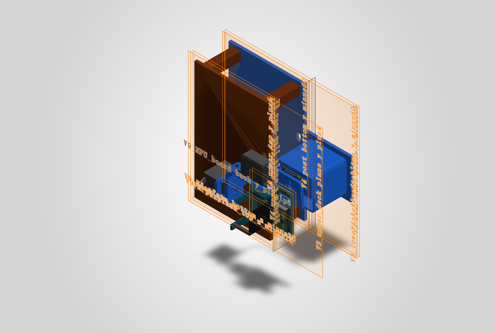

# 芯眸 · 多算法实时视觉跟踪系统

基于安路 PH1P35 / HX1P35A 的实时图像处理与三轴视觉伺服作品。摄像头采集图像，FPGA 完成图像算法、目标检测和状态叠加，RISC-V 固件驱动三轴云台。

本仓库整理于 2026-11-03，包含 TD 工程、FD 应用与配套平台、V10 SolidWorks 原生机械文件、仿真工程，以及已有烧录文件和报告。

## 工程入口

| 内容 | 路径 |
|---|---|
| TD 工程 | [camera_to_dsi_display.al](hardware/td/ph1p35_isp/prj/board/lab_ex3_osd/td_project/camera_to_dsi_display.al) |
| FD 应用 | [yuntai_mcu](firmware/fd/yuntai_mcu) |
| FD 硬件平台与 BSP | [MCU_fpga](firmware/fd/MCU_fpga) |
| SolidWorks 总装、零件与预览 | [V10 机械目录](mechanical/v10/V10_level_base_20261022) |
| ModelSim 图 5 / 图 7 仿真 | [verification/modelsim](verification/modelsim) |
| 最终 TD 烧录文件与实现报告 | [artifacts/fpga](artifacts/fpga) |
| 已有 MCU 固件 | [artifacts/firmware](artifacts/firmware) |

## 功能

M0 原图、M1 灰度、M2 自适应二值化、M3 边缘、M4 保色平滑、M5 红色及红绿蓝多色识别、M6 帧差运动检测、M7 素描保色、M8 动漫风格；前端支持自动曝光与增益、自动白平衡以及直方图均衡。目标中心坐标经接口传入 RISC-V，驱动云台跟随目标。屏幕叠加档位、帧率、坐标、处理延迟等信息。

## 换机后打开

1. 下载并解压本仓库，或 `git clone`。保留目录结构与原始文件名。
2. 使用 Python 3 在仓库根目录运行 `python tools/prepare_workspace.py`，也可双击 `tools/准备工程.cmd`。脚本设置 TD / FD 在本机的新路径，并还原三个无损压缩的全尺寸仿真激励文件。只查看或编译板级工程时，可以加 `--skip-stimuli`。
3. 在 TD 6.2 打开上表 `.al` 工程，器件为 PH1P35MDG324，顶层为 `design_top_wrapper`。工程引用的 82 个文件均保留。
4. 在 FD Release 2026.2 中，将 `firmware/fd` 下的 `MCU_fpga` 与 `yuntai_mcu` 两个已有工程一并导入工作区；先保留平台工程，再构建应用。
5. 在 SolidWorks 打开 V10 目录中的 `.SLDASM` 总装。12 个 `.SLDPRT` 零件与总装位于同一目录，应保持文件名不变。该目录为用户提供的原生设计文件，未包含打印 STL；原有说明中提及 STL 的内容属于此前设计过程记录。

### FD 命令行构建

在 FD 随附的构建终端中进入 `firmware/fd/yuntai_mcu`，按实际工具链设置前缀，例如：

```sh
make SDK_ROOT=../MCU_fpga COMPILE_PREFIX=riscv64-unknown-elf- TARGET=yuntai_mcu
```

`Makefile`、链接脚本、驱动、BSP、硬件描述 HPF、`.project`、`.cproject` 和 `.fd` 配置均已包含。IDE 的工具链仍由本机 TD / FD 安装提供。

## 烧录文件的版本

实际演示所用 FPGA 文件以 `artifacts/fpga/phy_1/camera_to_dsi_display.bit` 为准，来自用户确认的最终 TD 工程活动 `phy_1` 结果。同目录保留压缩 bit 和最终时序报告。

`MCU_fpga/platform` 内的 bit 是 FD 平台原有快照，与上述最终文件的 SHA-256 不同，作为该 FD 工程的一部分保留。两个文件的位置和 SHA-256 均记录于 [BASELINE.json](BASELINE.json)。

已有 `yuntai_mcu.bin` / `.elf` / `.map` 放在 `artifacts/firmware`。本次为工程整理与校验，未重新综合、布局布线、编译或上板验证。

## 仿真与校验

在 ModelSim 将工作目录切换到 `verification/modelsim`，运行 `do run_fig5_m5.do` 或 `do run_fig7_awb_i2c.do`。该目录保留 testbench、对应 RTL、脚本和已有波形记录。它们是用于报告图示的模块测试，并非完整系统仿真。

更多原有模块仿真和激励生成脚本位于 `hardware/td/ph1p35_isp/sim`。三个较大的 `.hex` 用 `.gz` 无损保存，路径准备脚本可恢复为逐字节一致的原始内容；历史工作库和重复运行缓存未纳入交付。

运行 `python tools/verify_package.py` 可核对文件 SHA-256、TD 引用、FD 工程入口和机械原始清单。机械文件保留原有 MIT 许可；厂商 IP、SDK 及其他第三方内容保留其文件头、原许可和加密形式。本仓库未统一替换这些许可。


